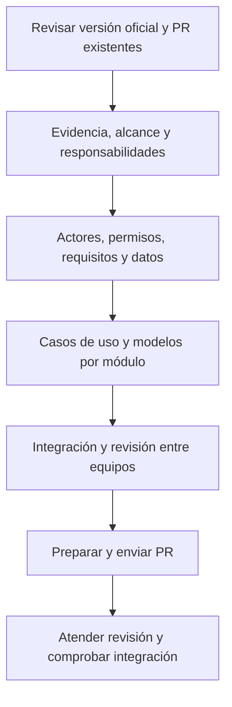

# Plan de trabajo del proyecto SCE

**Versión:** 1.0, 19 de noviembre de 2026.\
**Estado:** propuesta de coordinación para revisión del grupo.\
**Base oficial:** `develop`, commit `553104011ece92aeeeecfe54298173bfb88e102f`.\
**Entrega oficial y calendario:** por confirmar con el docente. No se asignan fechas ni horas de trabajo sin acuerdo de los responsables.

## Propósito y resultado esperado

Completar una especificación documental integrada del sistema de control escolar: problema y evidencia, alcance y exclusiones, requisitos verificables, actores y permisos, datos y reglas, casos de uso y modelos UML coherentes. Cada aportación debe responder a una necesidad y poder explicarse en la revisión individual del sistema completo.

El alcance de este plan es análisis, modelado y documentación. La encuesta informa necesidades de estudiantes; las decisiones institucionales requieren además la validación del equipo y las fuentes administrativas pertinentes. No se presupone un desarrollo o despliegue de software como entregable actual.

## Fuentes y reglas de decisión

- La [referencia oficial](<Referencia del repositorio oficial.md>) fija el estado revisado y los vínculos a la plantilla y a los materiales de clase.
- La plantilla vigente solicita componentes y secuencia por caso de uso, estados de objetos o clases, clases y casos de uso, con fuente UML e imagen.
- La clase 22 pide definir el dato principal, sus metadatos y condiciones por módulo y completar el modelo entidad-relación general. La clase 23 reitera coherencia, fuente e imagen y atención a comentarios de PR.
- Se usan tres niveles: sistema completo (0), módulos (1) y detalle de funciones (2), según la clase 21. La regla sobre diagramas de actividades mencionada en clases anteriores se debe aclarar si el docente la vuelve a exigir; la plantilla revisada no contiene ese apartado.
- Cada afirmación se etiqueta como **confirmada por fuente**, **testimonio**, **propuesta** o **pendiente de acuerdo**. Una propuesta de este plan no es una nueva instrucción del profesor.

## Equipos y responsabilidades de dominio

La distribución siguiente procede de [teams-info.md](https://github.com/wichis/26b_is1_proyecto-final/blob/553104011ece92aeeeecfe54298173bfb88e102f/teams-info.md). Se enlaza la lista de integrantes original para evitar mantener otra nómina que pueda desactualizarse.

| Equipo | Responsabilidad registrada | Coordinación que se propone para este plan |
|---|---|---|
| E1 | Alumnos e Inicio de Sesión | Identidad, cuentas y relación con perfiles; resolver versiones de Alumnos. |
| E2 | Inscripciones y Periodos | Ventanas temporales, inscripción, cupo y consumo de oferta académica. |
| E3 | Profesores | Perfil docente y revisión de dependencias con asignaturas, grupos y calificaciones. |
| E4 | Asignaturas/Materias | Catálogo académico, plan de estudios y seriación. |
| E5 | Calendario de exámenes y aulas/grupos | Espacios, programación y delimitación de la entidad grupo. |
| E6 | Calificaciones y Catálogo de exámenes | Actas, resultados y parámetros de evaluación. |

La coordinación general, la persona integradora y la persona revisora de cada tarea compartida deben acordarse. No se asignan automáticamente al E3 por alojar esta propuesta.

## Orden del trabajo

Las fases tienen criterios de salida. Se puede corregir el índice y preparar evidencia mientras se acuerda el alcance, pero el detalle de diagramas depende de requisitos y datos suficientemente definidos.

| ID | Trabajo y producto concreto | Dependencias | Responsable propuesto / revisión | Criterio para terminar | Estado inicial |
|---|---|---|---|---|---|
| T00 | Registrar versión oficial y PR existentes | Ninguna | Coordinación por acordar / todos | Commit, enlaces y estado real anotados; sin contar PR abiertos como entrega | Referencia preparada; mantener vigente |
| T01 | Preparar evidencia de encuesta y lectura exploratoria | Ninguna | E3 prepara; revisión de todos | Copia sin identificadores directos, método documentado y ejemplos rastreables por ID | Preparado para revisión |
| T02 | Corregir navegación del README | T00 | Integrador por acordar / responsables de cada módulo | Enlaces a los nueve archivos existentes; sin crear enlaces a módulos no integrados | Paquete PR-001 preparado |
| T03 | Acordar problemas, propósito, alcance y exclusiones generales | T00, T01 | Un representante por equipo / revisión conjunta | Cada problema tiene evidencia o etiqueta de hipótesis; inclusiones y exclusiones explícitas | Paquete PR-002 preparado como aporte parcial |
| T04 | Resolver límites de módulos y conceptos compartidos | T03 | E1–E6 / revisión cruzada | Un responsable para cada dato y operación común; grupos, recursos, matrícula e identidad resueltos o pendientes visibles | Por iniciar |
| T05 | Unificar actores, roles, permisos y RF/RNF generales | T03, T04 | E1 propone acceso; cada equipo valida sus operaciones | Matriz por operación y alcance; RF/RNF de nivel 0 relacionados con módulos; medidas sin valores inventados | Por iniciar |
| T06 | Definir datos, metadatos y reglas por módulo | T04, T05 | Cada equipo / equipo consumidor de sus datos | Tipos, formato, obligatoriedad, claves, referencias y validación acordados; dudas identificadas | Ficha E3 en PR-003; resto por iniciar |
| T07 | Describir los casos de uso hasta nivel 2 | T04–T06 | Cada equipo / revisión por otro equipo | Actor, condiciones, flujo, alternativas, entradas y salidas coherentes con requisitos | Por iniciar |
| T08 | Completar modelos requeridos por módulo | T06, T07 | Cada equipo / responsables de módulos relacionados | Casos de uso, componentes y secuencia por CU, estados y clases; fuente UML más imagen legible | Por iniciar |
| T09 | Consolidar entidad-relación y vistas generales | T04–T08 | Un representante por equipo / revisión conjunta | Entidades, cardinalidades, identificadores y responsabilidades coherentes; una vista acordada de contexto y componentes | Por iniciar |
| T10 | Preparar interfaz documental y criterios de calidad | T05, T07 | Cada equipo / revisión cruzada | Mockups o wireframes acordados y relacionados con casos de uso; criterios de aceptación con condiciones conocidas | Por iniciar |
| T11 | Homogeneizar, revisar y preparar entrega | T02–T10 | Integrador por acordar / todos | Enlaces, nombres, fuentes, imágenes, ortografía y relaciones revisados; exposición individual preparada | Por iniciar |

“Preparado” significa que existe material consultable en este repositorio. La aceptación del grupo, el envío de PR y la integración oficial se registran aparte.

## Decisiones que impiden cerrar el diseño

| ID | Decisión necesaria | Equipos que deben acordarla | Evidencia de cierre |
|---|---|---|---|
| D01 | Versión única de Alumnos: PR #48 frente a #51; relación con Inicio de Sesión #47 | E1, integrador | Archivo canónico y funciones que administra frente a las que solo consulta. |
| D02 | Responsable de grupos, oferta por periodo y asignación docente | E2, E3, E4, E5 | Definición de grupo y dueño de creación, cupo, horario y docente. |
| D03 | Diferencia entre matrícula/identificador visible, ID interno y cuenta | E1, E2, E3 | Claves y relaciones acordadas; generación y activación de matrícula asignadas. |
| D04 | Jerarquía de actores y roles simultáneos | Todos; E1 consolida propuesta | Catálogo de roles y matriz de permisos compatible con el diagrama propuesto en #54. |
| D05 | Propietario de ventanas de inscripción, captura de notas y exámenes | E2, E5, E6 | Reglas temporales sin configuraciones duplicadas o contradictorias. |
| D06 | Qué incluye “recurso” y cómo se relaciona con aulas | E5 y consumidores | Catálogo o clasificación y condiciones de disponibilidad definidas. |
| D07 | Datos que el profesor puede editar en su perfil y qué administra Control Escolar | E1, E3 | Lista por campo y permiso; sin contradicción entre RF-07 y RNF-01. |
| D08 | Normas de evaluación, plazos, conservación y calidad medible | E6, responsables de cada módulo, docente | Fuente institucional o acuerdo explícito; ninguna cifra se inventa a partir de testimonios. |

No es necesario resolver estas decisiones hoy para consultar el plan. Se resuelven antes de presentar como definitivos los modelos que dependen de ellas.

## Regla para aceptar una tarea

Cada tarea debe indicar necesidad, fuente, producto, responsable que la acepta, dependencias y criterio de cierre. Una tarea se pasa a revisión cuando el producto existe y permite comprobar el criterio. Si cambia una regla compartida, se anotan los módulos afectados y se revisan sus requisitos, modelos y datos.

Para cada requisito se propone mantener una fila de trazabilidad: `ID → fuente o necesidad → módulo responsable → caso de uso → datos/reglas → modelos → criterio de aceptación → PR`. Esto es un instrumento de coordinación propuesto, no un nuevo formato obligatorio del docente.

## Primera sesión de coordinación propuesta

1. Cada equipo revisa su fila, acepta un enlace de coordinación y confirma sus PR abiertos.
2. Se acuerdan D01–D07 o se registran responsables y fuentes que faltan para resolverlas.
3. Se revisan los paquetes PR-001 y PR-002 para repartir las secciones comunes del README sin duplicar los PR existentes.
4. Cada equipo identifica sus datos y casos de uso y estima su trabajo después de acordar el alcance.
5. Se fija la siguiente revisión y se confirma con el docente la fecha oficial. Hasta entonces, el calendario sigue por confirmar.

## Cómo proponer cambios al profesor

Usar [los paquetes de propuestas](<Propuestas de cambios/README.md>). Primero actualizar la referencia oficial, revisar si ya existe un PR equivalente, aplicar solo el cambio propio en una rama basada en `develop`, comprobar los archivos afectados y preparar una descripción de menos de 50 palabras. Los commits deben tener menos de 24 palabras, según el template vigente. El envío al repositorio oficial lo realiza el integrante responsable cuando el equipo haya revisado su aportación.
